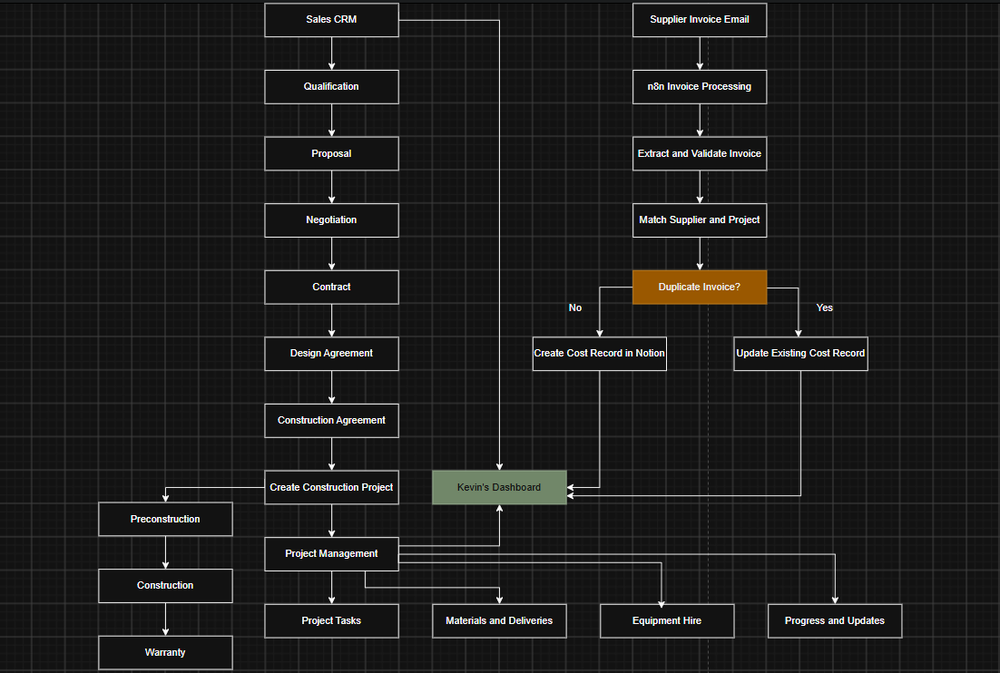
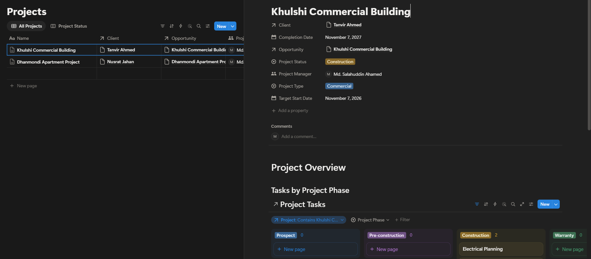
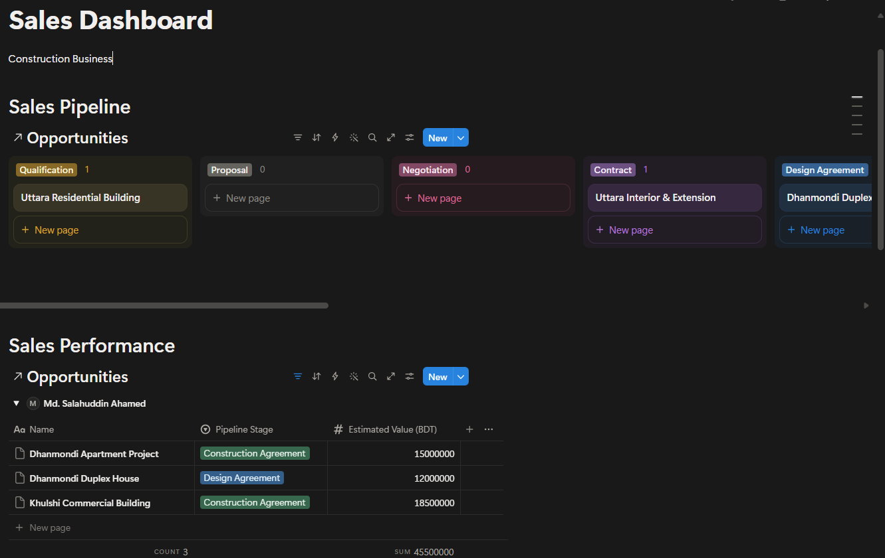
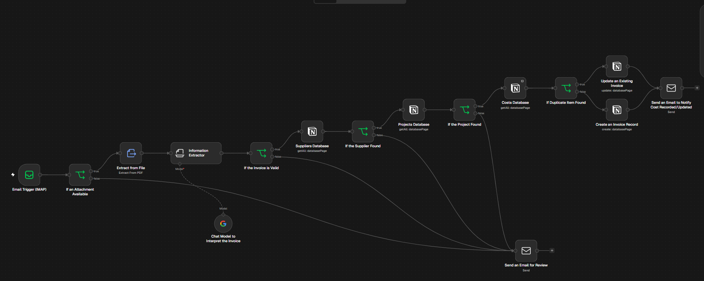

# Business Management & Workflow Automation

A business management workspace built with **Notion** and an automated invoice-processing workflow developed using **n8n**, integrated with Google Gemini AI.

The project demonstrates how business information can be organised in Notion and how repetitive invoice-processing tasks can be automated through API integrations and AI-assisted data extraction.

## 1. Project Overview

The project consists of two connected components:

- **Notion Business Management Workspace:** Organises sales, customers, construction projects, tasks, materials, equipment, suppliers and expenses through relational databases and dashboards.
- **n8n Invoice Processing Automation:** Automates invoice collection from email, information extraction, validation, duplicate checking and record creation in Notion.

The main objective is to reduce manual data entry, improve information management and provide a more organised approach to business operations.

## 2. Technologies Used

| Technology | Purpose |
|---|---|
| Notion | Business workspace, databases and dashboards |
| n8n | Workflow automation and API integration |
| Google Gemini API | AI-assisted invoice information extraction |
| REST APIs | Communication between external services |
| Email / SMTP | Invoice communication and processing |
| Docker | Local deployment of the automation environment |

## 3. System Architecture

The system connects email, n8n, Google Gemini and Notion.

Incoming invoice emails are processed through n8n. The workflow extracts invoice information using Google Gemini, validates the extracted data and checks for possible duplicates before creating or updating the corresponding records in Notion.

Notion acts as the central business information workspace.

### Architecture Diagram



**Main data flow:**

Email → n8n → Invoice Extraction → Validation → Duplicate Check → Notion

### Component Responsibilities

**Notion**
- Stores business and project information.
- Maintains supplier, customer and invoice records.
- Connects related records through database relations.
- Provides dashboards and filtered views.

**n8n**
- Receives invoice emails.
- Retrieves invoice attachments.
- Coordinates AI-assisted information extraction.
- Validates extracted information.
- Checks for possible duplicate invoices.
- Communicates with Notion through its API.

**Google Gemini**
- Assists in extracting structured information from invoice documents.
- Returns invoice details for further validation and processing.

## 4. Notion Business Management Workspace

The Notion workspace provides a central location for managing business operations.

### 4.1 Main Databases

**Sales CRM**
- Customer and company information
- Contact details
- Lead sources and sales status
- Follow-up information
- Related projects

**Construction Projects**
- Project name and reference
- Client information
- Project status
- Start and expected completion dates
- Related tasks, materials and equipment
- Suppliers and project expenses

**Project Tasks**
- Task descriptions
- Assigned persons
- Priority and status
- Due dates
- Related projects

**Materials**
- Material names and categories
- Quantities and units
- Suppliers
- Related projects
- Cost information

**Equipment**
- Equipment details and categories
- Availability status
- Hire information
- Suppliers
- Related projects and costs

**Suppliers**
- Supplier names and contact information
- Email and address
- Supplier categories
- Related invoices and projects

**Invoices and Expenses**
- Invoice number and date
- Supplier information
- Invoice amount and currency
- Due date and status
- Related project
- Processing information

### 4.2 Database Relationships

Notion relations connect the different databases.

Examples:

- One customer can be associated with multiple projects.
- One project can contain multiple tasks.
- Projects can be associated with materials and equipment.
- One supplier can have multiple invoices.
- Invoices can be linked to suppliers and relevant projects.

Rollups and database views can be used to present related information and support project tracking.

### 4.3 Project Management View



The project management workspace provides an overview of construction projects and their related information, helping users track project activities and progress.

### 4.4 Sales Dashboard



The sales dashboard provides an overview of customer and sales information, including lead tracking and related business activities.

## 5. Invoice Processing Workflow

The n8n workflow automates the process of receiving invoices and transferring relevant information into Notion.

### 5.1 Workflow Diagram



### 5.2 Processing Steps

**Step 1 – Receive Invoice Email**

The workflow receives incoming invoice emails through the configured email integration and identifies relevant messages.

**Step 2 – Retrieve Invoice Attachment**

The workflow retrieves the attached invoice document for further processing.

**Step 3 – AI-Assisted Information Extraction**

Google Gemini API assists in extracting relevant invoice information, such as:

- Supplier name
- Invoice number
- Invoice date
- Due date
- Total amount
- Currency
- Tax information
- Project-related information

**Step 4 – Validate Extracted Information**

The extracted information is checked for required fields, missing values and incorrect formats.

**Step 5 – Duplicate Checking**

Existing invoice records are checked for possible duplicates using available information such as supplier name and invoice number.

**Step 6 – Supplier and Project Matching**

The workflow searches the relevant Notion databases to identify matching suppliers and projects.

**Step 7 – Create or Update Notion Records**

After processing and validation, the invoice information is transferred to Notion and associated with the relevant records where a reliable match is available.

**Step 8 – Review and Exception Handling**

Invoices with missing information, uncertain matches or processing errors may require manual review.

## 6. Testing and Validation

The workflow should be evaluated using different invoice scenarios to check data accuracy and processing behaviour.

| Test scenario | Expected behaviour |
|---|---|
| Valid invoice | Extract information and create a Notion record |
| Missing attachment | Identify the missing document |
| Incomplete invoice | Flag missing or unclear information |
| Duplicate invoice | Identify a possible existing record |
| Unknown supplier | Avoid incorrect supplier matching |
| Notion API failure | Identify the failed operation |

### Data Validation

Before creating an invoice record, the workflow should check:

- Invoice number
- Supplier name
- Invoice date
- Due date
- Invoice amount
- Currency
- Supplier and project relationships

### Duplicate Detection

Duplicate checking can use a combination of supplier information, invoice number, date and amount.

Potential duplicates should be reviewed before creating another invoice record.

*Testing results should be recorded after running each scenario. The expected behaviour above does not imply that every test has already been executed successfully.*

## 7. Security and Configuration

The workflow requires separately configured credentials in n8n.

### Required Credentials

- Google Gemini API credentials
- Notion API credentials
- SMTP or email integration credentials, depending on the configured email nodes

Before executing the workflow:

1. Configure the required credentials in n8n.
2. Import the workflow JSON.
3. Assign the appropriate credentials to the relevant nodes.
4. Configure the Notion database and integration permissions.
5. Update the sender and recipient email addresses.
6. Test the workflow using sample invoice documents.

**Security considerations:**

- API keys and passwords are not included in the public repository.
- Personal email addresses and private workspace information should be replaced with placeholders.
- Sample invoices should contain dummy information.
- Credentials should be managed through n8n rather than hardcoded in workflow nodes.

## 8. Limitations and Future Improvements

This project is a prototype and can be extended in several areas.

**Invoice Extraction**
- Support additional invoice formats.
- Improve extraction accuracy for scanned documents.
- Introduce confidence-based manual review.

**Duplicate Detection**
- Improve matching using supplier, invoice number, date and amount.
- Handle corrected and revised invoices.
- Introduce stronger duplicate prevention.

**Error Handling**
- Add controlled retries for temporary failures.
- Improve error logging and notifications.
- Support safe reprocessing of failed invoices.

**Reporting and Analytics**
- Add supplier-based expense reports.
- Provide project expense summaries.
- Track outstanding and overdue invoices.

**Scalability and Security**
- Improve processing of multiple attachments.
- Introduce execution monitoring.
- Strengthen access control and audit logging.

## 9. Getting Started

### Prerequisites

- A Notion workspace
- An n8n instance
- Google Gemini API access
- An email account supported by the configured integration
- Docker, if using the included local deployment configuration

### Setup

**1. Clone the repository**

```bash
git clone https://github.com/sumuongit/business-management-workflow-automation.git
cd business-management-workflow-automation
```

**2. Configure n8n**

Start your local n8n environment using the included Docker configuration, if applicable.

**3. Import the workflow**

Import:

```text
n8n/invoice-processing-workflow.json
```

into your n8n instance.

**4. Configure credentials**

Set up Google Gemini, Notion and email credentials in n8n.

**5. Configure Notion**

Ensure the Notion integration has access to the required databases and that the database properties match the workflow configuration.

**6. Test the workflow**

Use sample invoice documents and verify the extracted information and resulting Notion records.

## 10. Project Structure

```text
business-management-workflow-automation/
│
├── README.md
├── n8n/
│   └── invoice-processing-workflow.json
│
├── screenshots/
│   ├── flow-diagram.png
│   ├── n8n-workflow.png
│   ├── projects.png
│   └── sales-dashboard.png
│
├── sample-data/
├── docker/
├── .gitignore
└── .gitattributes
```

## 11. Project Purpose

This project demonstrates practical experience in:

- Business process automation
- Notion database design and relational data management
- n8n workflow development
- AI-assisted document processing
- REST API integration
- Invoice validation and duplicate checking
- Backend integration and workflow design

It provides a foundation for further development of business management and automation solutions.

---

**Author:** Md. Salahuddin Ahamed

**GitHub:** [sumuongit](https://github.com/sumuongit)

**Project:** Business Management & Workflow Automation